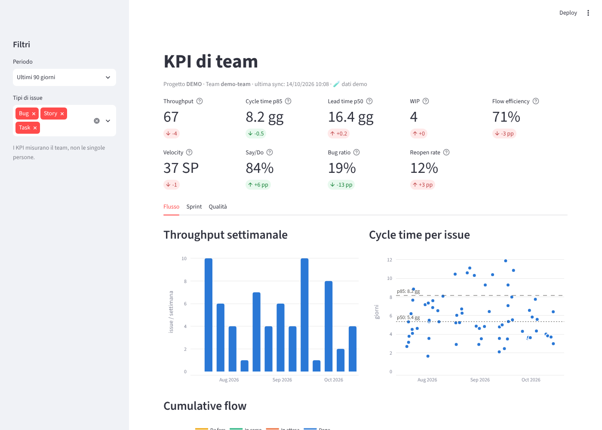

# Jira KPI Dashboard

Dashboard che raccoglie da **Jira Cloud** i dati di un progetto e di un team e li trasforma
in **KPI di performance del team** (flusso, Scrum, qualità). Sviluppata in TDD.

> I KPI misurano il **sistema di lavoro del team**, non le singole persone: non ci sono
> metriche per assegnatario, ed è una scelta voluta.



## Avvio rapido (dati demo, senza Jira)

```bash
uv venv && uv pip install -e ".[dev]"
uv run jira-kpi dashboard --demo        # http://localhost:8501
```

## Uso con Jira

```bash
cp config.example.yaml config.yaml      # progetto, team, mapping degli stati
cp .env.example .env                    # JIRA_EMAIL + JIRA_API_TOKEN
uv run jira-kpi discover-fields         # trova gli id dei campi Story Points / Sprint / Team
uv run jira-kpi sync                    # prima volta: completa; poi incrementale
uv run jira-kpi sync --full             # risincronizza da zero (es. issue uscite dal team)
uv run jira-kpi dashboard
```

Il team si identifica con la JQL `project = "<project>" AND "<team_field>" = "<team>"`
(di default il campo Atlassian *Team*), oppure con `jql_override`.

## KPI

| Area | KPI | Definizione |
|---|---|---|
| Flusso | Throughput | Issue completate per settimana |
| | Cycle time (p50/p85/p95) | Primo stato attivo → Done; escluse le issue mai avviate |
| | Lead time | Creazione → Done |
| | WIP / Cumulative flow | Issue per categoria a fine giornata |
| | Flow efficiency | Tempo *in corso* / tempo di ciclo (attesa e ritorni a To Do sono attesa) |
| | Aging WIP | Età delle issue in lavorazione, evidenziata se oltre il p85 del cycle time |
| Scrum | Velocity | SP completati negli sprint chiusi (+ media mobile a 3) |
| | Say/Do | SP **committati all'avvio** completati / SP committati |
| | Scope change | SP aggiunti / rimossi dopo l'avvio |
| | Carry-over | Issue nello sprint a fine sprint non completate |
| Qualità | Bug ratio | Bug creati / issue completate nel periodo |
| | Tempo risoluzione bug | Lead time dei bug per priorità |
| | Reopen rate | Issue completate che erano state riaperte |

Ogni tile mostra il delta rispetto al periodo precedente di uguale durata. Lo sprint in corso
è escluso da velocity e say/do (tile e grafici, dati parziali) e mostrato a parte con
l'avanzamento calcolato a oggi. Una issue riaperta conta come completata alla
sua **ultima** chiusura.

## Architettura

```
JiraClient ──► SQLite (JSON grezzo) ──► IssueMapper ──► dominio ──► KPI (funzioni pure) ──► viewmodel ──► Streamlit
```

- `domain/` modelli immutabili e ricostruzione della timeline dal changelog
- `kpi/` calcoli puri, senza I/O: `flow.py`, `scrum.py`, `quality.py`
- `jira/` client HTTP (`/rest/api/3/search/jql`, retry su 429/5xx) e mapper
- `storage/` snapshot: si salva il JSON grezzo, così cambiare il mapping non richiede di riscaricare
- `app/` viewmodel puro + grafici Plotly + pagina Streamlit

## Sviluppo

```bash
uv run pytest -m "not e2e" --cov         # unit + integrazione (soglia 80%)
uv run pytest -m e2e                      # E2E Playwright (richiede .[e2e] e Chromium)
uv run ruff check . && uv run ruff format --check . && uv run mypy
```

## Limiti noti

- Gli story points sono il valore **attuale** (le ristime durante lo sprint non sono ricostruite).
- La sync incrementale non rimuove le issue uscite dalla JQL: usare `sync --full`.
- Gli sprint sono ricavati dalle issue (campo Sprint), non dall'API Agile.
